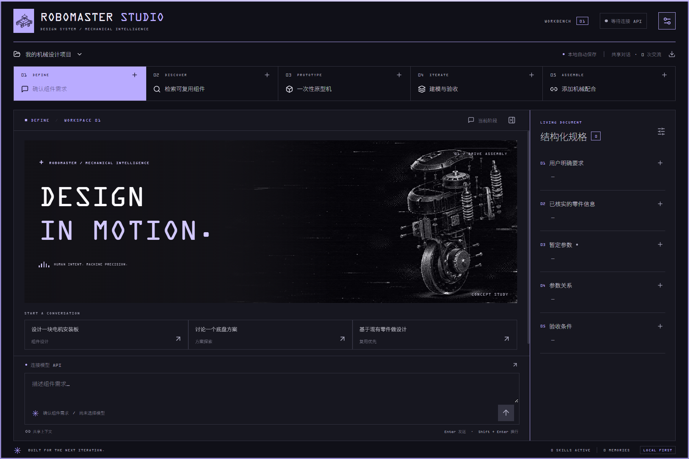
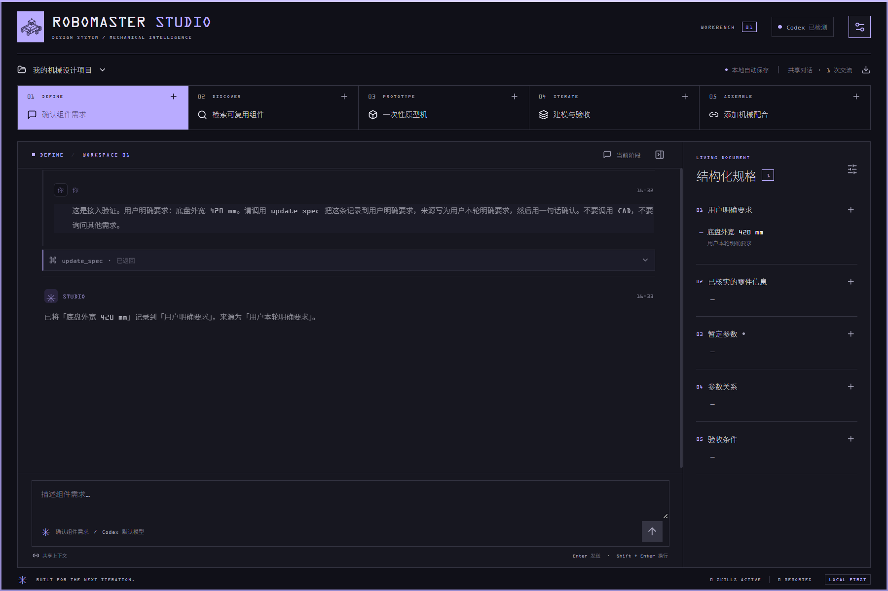
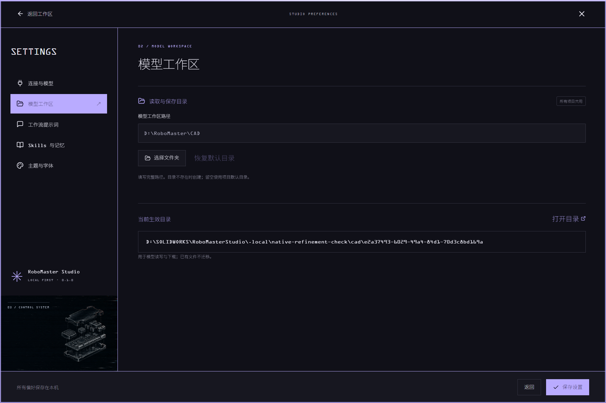
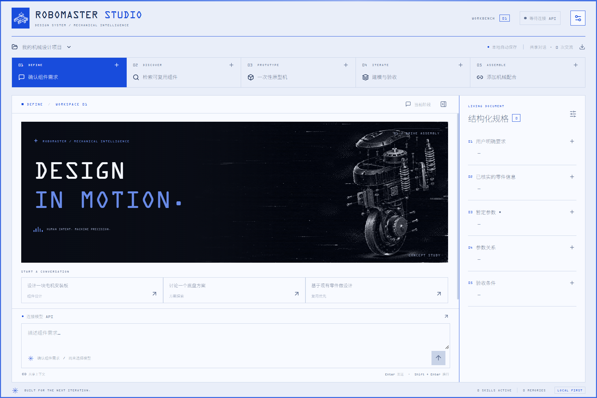
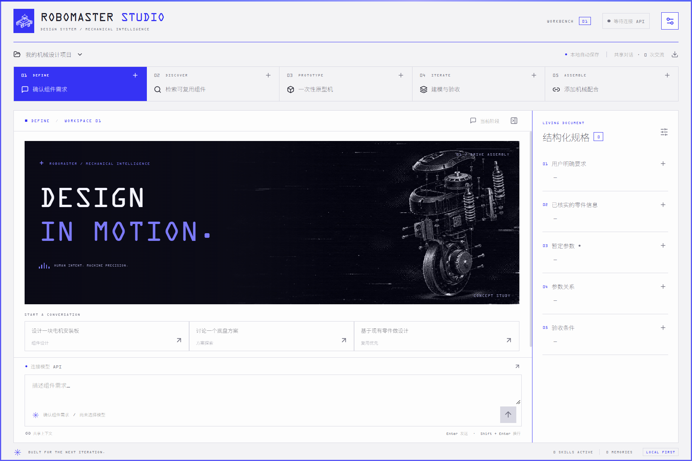
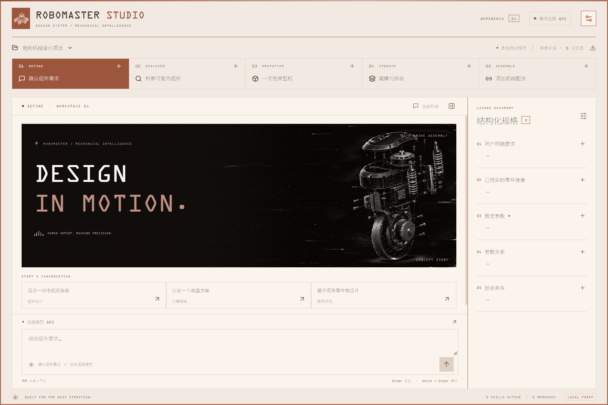

<div align="center">

# RoboMaster Studio

**DESIGN IN MOTION.**

从组件需求，到可复用零件、外形原型、迭代验收与机械配合。

Rust · Tauri 2 · SolidWorks MCP · Codex · DeepSeek Harness

[下载 Codex 桌面版](https://github.com/haku-nomisugiru/autorobomaster/releases/download/studio-v0.2.0/RoboMaster-Studio-Codex-v0.2.0-win-x64.zip) · [下载 DSH 插件](https://github.com/haku-nomisugiru/autorobomaster/releases/download/studio-v0.2.0/RoboMaster-Studio-DSH-v0.2.0.zip) · [发行说明](https://github.com/haku-nomisugiru/autorobomaster/releases/tag/studio-v0.2.0)



</div>

面向 RoboMaster 机械设计的本地工作台。五个阶段共享同一条项目对话，把需求、参数、来源、模型操作与验收证据一起保存。通过 [SolidWorks Automation MCP](https://github.com/wzyn20051216/solidworks-automation-skill) 连接本机 SolidWorks；可使用已有 Codex 登录、兼容模型 API，或作为原生插件运行在 DeepSeek Harness 内。

> 当前版本为 **Studio 0.2.0**。本仓库保留旧 C# 工作台；新版源码位于 `studio/`，使用独立标签 `studio-v0.2.0`。旧版说明与下载仍见 [C# v1.1.0](https://github.com/haku-nomisugiru/autorobomaster/tree/v1.1.0)。两者的数据格式不同，不自动迁移。

## 选择你的入口

| | Codex 桌面版 | DSH 原生插件 |
| --- | --- | --- |
| 运行方式 | 独立 Rust / Tauri Windows 程序 | 安装在 DeepSeek Harness 当前会话中 |
| 模型来源 | 本机 Codex 登录；也可切换 Responses / Chat Completions API | DSH 自己配置的模型与账户 |
| 开始使用 | 解压后运行 `Start-Codex-Studio.cmd` | DSH「插件 → 添加插件」选择解压目录 |
| 对话与数据 | Studio 项目持久化；便携包旁的 `data/` | DSH 对话；插件状态按会话隔离 |
| 外观 | 墨夜、研究白、蓝图、陶土；可选字体 | 随 DSH 当前主题切换 |
| 下载 | [Windows x64 ZIP](https://github.com/haku-nomisugiru/autorobomaster/releases/download/studio-v0.2.0/RoboMaster-Studio-Codex-v0.2.0-win-x64.zip) | [插件 ZIP](https://github.com/haku-nomisugiru/autorobomaster/releases/download/studio-v0.2.0/RoboMaster-Studio-DSH-v0.2.0.zip) |

需要可正常运行的 SolidWorks 和单独安装的上游 MCP，才能执行 CAD 操作。桌面版还需要 Windows 10/11 x64 与 WebView2 Runtime。安装包不包含 SolidWorks、模型额度、字体或 RAG 的 CAD 资产。

## 一个项目，五个阶段

| 阶段 | 你可以做什么 | 阶段约束 |
| --- | --- | --- |
| **01 · 确认组件需求** | 与模型讨论用途、接口、尺寸；同步维护右侧规格 | 需求讨论阶段不能修改 CAD |
| **02 · 检索可复用组件** | 查询本地 CAD RAG 与 step.parts，检查来源与复用条件 | 搜索结果仍需核实，下载不等于工程验收 |
| **03 · 一次性原型机** | 建立外形原型，检查明显异常的几何与包围盒 | 不执行测试、干涉分析、仿真或工程验收 |
| **04 · 建模与验收** | 查看编号迭代、失败原因、修正与实际工具证据 | 人工审阅后接受该轮结果 |
| **05 · 添加机械配合** | 点击「开始」，发送可编辑的配合提示词 | 遇到歧义时暂停，等待用户选择 |

每类窗口都可用 **＋** 多开；同类最后一个窗口不能关闭。窗口保留各自的输入草稿，共享项目对话与规格。SolidWorks 调用串行执行。

右侧规格持续区分 **用户明确要求、已核实的零件信息、暂定参数、参数关系、验收条件**，使假设和已有证据在讨论中保持可见。

## Codex 接入：从回答到真实工具结果



上图来自最终桌面程序的真实接入测试：Codex 调用 `update_spec`，将 **底盘外宽 420 mm** 写入「用户明确要求」，重载后仍保留。这验证了模型调用、工具执行与本地持久化；该测试没有创建或验收 CAD 模型。

1. 下载并完整解压桌面包；先安装并登录 Codex，再运行 `Start-Codex-Studio.cmd`。
2. 打开右上角设置 → **连接与模型**，选择 Codex，点击 **保存并测试模型**。模型 ID 可留空，使用 Codex 默认模型。
3. 如自动查找失败，填写 `codex.exe` 的完整路径。无需把登录凭据复制到 Studio。
4. 配置上游 MCP 的 Python 解释器和 `mcp-server/server.py`，点击 **连接 / 重连 MCP**。
5. 在 **模型工作区** 选择读取与保存模型的文件夹，回到需求页开始讨论。

Studio 保存自己的项目历史，不接管 Codex 桌面中的已有聊天。当前适配器经过 Codex CLI `0.167.0-alpha.4.1` 实测；协议兼容性和超时处理见 [接入说明](docs/INTEGRATIONS.md)。

## DSH 接入：在当前会话打开工作台

1. 解压插件包到固定目录，打开 DSH → **插件 → 添加插件**，输入包含 `package.json` 的目录，安装并启用。
2. 在会话输入框上方点击 **ROBOMASTER / STUDIO → 展开**，打开完整工作台。关闭工作台后仍停留在原会话。
3. 工作台设置中配置模型工作区、MCP Python 与 `server.py`，点击 **测试 MCP**。
4. 使用 DSH 自己的模型配置发送需求；插件通过 `robomaster_studio` 工具读写规格、检索组件、记录迭代与调用 CAD。

插件更新后需要重启 DSH。本地安装通过目录链接加载，不要移动已安装的插件目录。已验证 DSH `0.2.1-rc.3` 的原生安装、界面、工具入口与 MCP 握手；**尚未完成真实 DeepSeek 推理测试**。详见 [插件说明](plugins/dsh/README.md)。

## 模型工作区、记忆与 Skills

在「设置 → 模型工作区」输入完整路径，例如 `D:\RoboMaster\CAD`，也可以选择文件夹。保存后作为后续模型读取、保存、导出与下载的位置；切换目录不搬动已有文件。桌面版工作区设置对所有项目生效，DSH 插件按会话保存。



*工作区界面展示沿用 0.1 系列截图；截图中的本地测试路径仅作示例。0.2 保留相同的目录设置方式。*

记忆与技能参考 Hermes Agent 的机制，使用独立实现：

- **持续记忆与历史检索**：保存项目事实与工具证据，按需要检索。
- **长对话摘要**：压缩上下文，同时保留原始历史及完整的工具调用 / 结果配对。
- **一次点选，记录偏好**：模型不确定时调用 `ask_user` 暂停；用户选择后继续，并记录情境偏好。选择本身不会变成「已验证」事实。
- **经验整理为技能**：从迭代记录生成 skill 草稿；支持导入单个 Markdown 技能，在设置中查看、编辑与启停。
- **按需加载**：模型先发现技能目录，再加载相关内容；导入和总结的草稿默认不启用。

设置还可编辑五个阶段的提示词、机械配合提示词、主题和字体。机制来源与实现差异见 [Hermes 机制映射](docs/HERMES.md)。

## 视觉与交互

默认 **墨夜**，英文与数字使用本机 **OCR A Extended**，中文使用 **Noto Sans SC Thin**。机械爆炸图、细线网格、缓慢的按钮边缘流光与轻微视差构成工作台视觉；无人物或人物雕塑。图片为概念插画，不是当前 CAD 的实时预览。

| 墨夜 · 默认 | 蓝图 |
| --- | --- |
|  |  |
| **研究白** | **陶土** |
|  |  |

切换主题时，标题、按钮、边框流光与机械图板共同使用当前主题色。动画遵循系统「减少动态效果」偏好。缺少本机字体时显示提示并使用回退字体；发布包不附带字体文件。完整规范见 [视觉系统](docs/DESIGN.md)。

## 验证状态与当前边界

| 验证 | 结果 |
| --- | --- |
| Rust 核心回归 | 23 项通过 |
| 真实 Codex 工具往返 | 1 项独立测试通过；最终桌面程序完成规格写入与重载 |
| 界面回归 | 16 项原有测试 + 1 项 Codex 设置测试通过 |
| DSH 状态与路径 | 2 项通过，覆盖越界、目录链接、待确认项与状态恢复 |
| DSH 原生宿主 | 安装、弹窗操作、主题、会话命令、模型工具入口与 MCP 握手通过 |
| 模型驱动真实 CAD 全流程 | **未完成整车或复杂装配的端到端机械验收** |

这些是本地验证记录，不是当前仓库 CI 成功徽章。详细范围见 [0.2 接入与验证](docs/INTEGRATIONS.md)；此前的界面、RAG 和下载验证见 [0.1 验证记录](docs/VALIDATION.md)。

CAD 超时或取消可能意味着执行结果未知，程序不会自动重试该操作。上游工具成功与零件满足机械要求分别记录。step.parts 入口使用公开目录搜索接口，不声称提供未公开的 text-to-CAD 生成 API。

## 从源码构建

需要 Node.js 22+、Rust stable MSVC、Visual Studio C++ Build Tools 与 Windows SDK。从本仓库克隆后进入 `studio/`；如果只下载了 Studio 子目录，直接在该项目目录执行后续命令。

```powershell
git clone https://github.com/haku-nomisugiru/autorobomaster.git
Set-Location autorobomaster\studio
npm.cmd ci
.\build.ps1 -Dev                     # 桌面开发模式
.\build.ps1                          # Windows release EXE
.\build.ps1 -Test                    # 构建、Rust 测试与界面回归
node --test tests/dsh-service.test.mjs
.\scripts\package-integrations.ps1   # Codex 桌面包与 DSH 插件包
```

仅预览界面可运行 `npm.cmd run dev`；浏览器模式会标明「界面预览」，不执行模型与 CAD。界面回归需要 Playwright Chromium；真实 Codex、SolidWorks 与 RAG 测试需要对应本机环境。

```text
studio/
├─ src/                 React 界面、五阶段交互与主题
├─ src-tauri/src/        Rust 模型适配、工具循环、SQLite、工作区与 MCP
├─ plugins/dsh/          DSH 原生 Host / Client 插件
├─ images/              机械概念插画
├─ scripts/             构建、打包与集成检查
├─ tests/               界面与 DSH 回归
└─ docs/                架构、来源、使用说明、截图与验证范围
```

## 数据、文档与许可

桌面便携包把项目数据放在程序旁的 `data/`；直接启动 EXE 使用 Tauri 的用户数据目录。DSH 插件默认使用 `%LOCALAPPDATA%\RoboMasterStudio\dsh`。模型工作区和应用数据目录各自管理。详见 [完整使用说明](docs/USAGE.md)。

API Key 存入 Windows Credential Manager；Codex 与 DSH 使用各自的登录。项目数据库与发布包不包含这些凭据。模型请求与自动摘要会将相关对话、规格、记忆、启用的技能和工具结果发送到所配置的模型服务。

[使用说明](docs/USAGE.md) · [Codex / DSH 接入](docs/INTEGRATIONS.md) · [架构](docs/ARCHITECTURE.md) · [Hermes 机制](docs/HERMES.md) · [视觉系统](docs/DESIGN.md) · [第三方声明](THIRD_PARTY_NOTICES.md)

沿用本仓库 [MIT License](LICENSE)。第三方依赖、模型资产与字体各自遵循其许可。本项目与 Nous Research、DJI、RoboMaster 及 Dassault Systèmes 无隶属关系。
