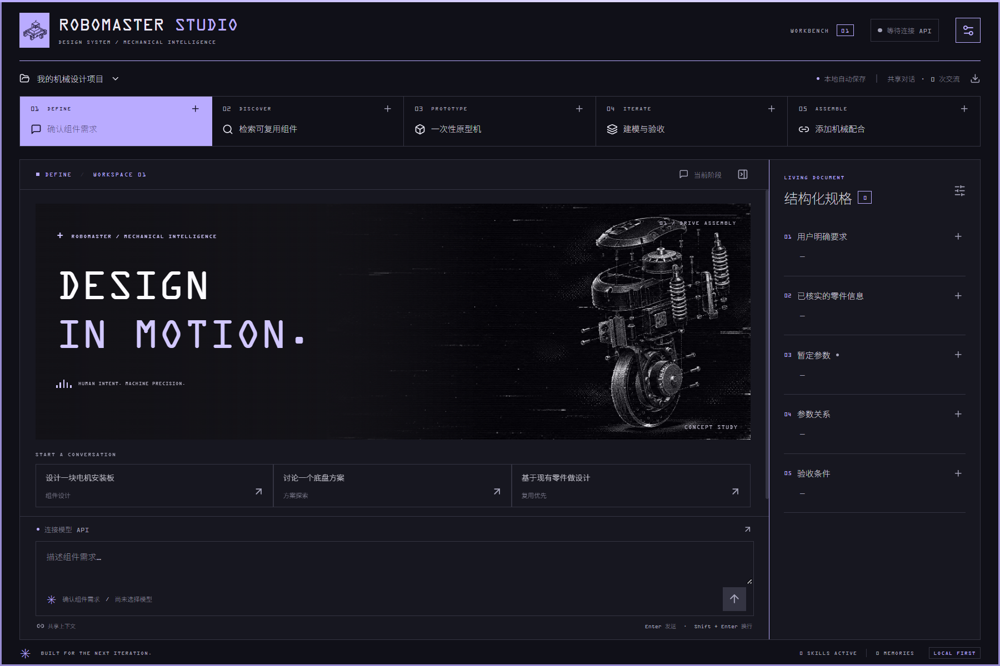

# RoboMaster Studio

Rust + Tauri 2 的 Windows 机械设计工作台。将需求讨论、本地 CAD RAG / step.parts 检索、外形原型、迭代建模验收与机械配合放进同一个持久项目。

**0.2.0 新增 Codex 接入与 DSH 原生插件。** 使用方式、两种版本的边界和实测记录见 [Codex / DSH 接入说明](INTEGRATIONS.md)。DSH 插件源码位于 [plugins/dsh](../plugins/dsh/README.md)，通过 DSH 自己的插件管理器安装。



界面默认使用墨夜、OCR A Extended 英文数字与 Noto Sans SC Thin 中文，配合机械结构爆炸图和缓慢的按钮边缘流光；使用用户提供的三张原图，不含人物素材。布局、字体加载、动效与参考观察记录见 [视觉系统](DESIGN.md)。

## 启动

Codex 便携包位于 `release/RoboMaster-Studio-Codex-v0.2.0-win-x64.zip`，解压后运行 `Start-Codex-Studio.cmd`，数据保存在包内 `data/`。DSH 插件包为 `release/RoboMaster-Studio-DSH-v0.2.0.zip`。旧版便携目录保留，升级不会自动覆盖旧项目。

构建原件位于 `src-tauri/target/release/robomaster-studio.exe`。双击程序，或运行 `launch.ps1`，使用用户默认数据目录。完整实测记录见 [验证记录](VALIDATION.md)。

首次进入右上角设置：

1. 选择 Codex 本机登录，或填写模型 API 基础地址、模型 ID、API Key。支持 Chat Completions 兼容 API 与 Responses API。Codex 模式可留空模型 ID，使用已有登录和默认模型；API 模式模型需支持 function calling。点击「保存并测试模型」会发送一次真实短请求。
2. 选择 [SolidWorks MCP](https://github.com/wzyn20051216/solidworks-automation-skill) 的 Python 解释器与 `mcp-server/server.py`。默认探测用户目录下 `.codex/mcp/solidworks-automation-skill`；可修改为任意已有安装路径。点击「连接 / 重连 MCP」完成协议握手与工具发现，不操作 CAD。
3. 启动现有 CAD RAG HTTP 服务，默认 `http://127.0.0.1:8765`，点击检查连接。当前工作区可运行：

```powershell
Set-Location D:\SOLIDWORKS\RoboMasterCADLibrary
.\.venv\Scripts\python.exe -B tools\http_service.py --port 8765
```

原生建模依赖本机可用的 Windows、SolidWorks、上游 MCP Python 依赖及兼容权限。程序自身需要 Windows WebView2 Runtime（多数 Windows 10/11 已安装）。

## 模型工作区

在「设置 → 模型工作区」输入电脑上的完整文件夹路径，例如 `D:\RoboMaster\CAD`，或点击「选择文件夹」，然后保存设置。支持中文、空格与可访问的网络共享目录；保存时检查目录读写权限，不存在的目录会自动创建。无效路径不会替换原设置。

设置后所有项目的模型读写使用该目录。模型可通过 `list_workspace_files` 查看其中的 CAD 文件与子目录，相对文件路径按工作区解析，保存与导出必须落在所选目录内；下载文件保存在 `downloads/<project-id>/`。切换后 MCP 会重新使用新路径，历史对话中的旧输出路径不能继续作为保存位置。用户明确提供的外部绝对路径仍可用于读取零件或模板。

路径偏好重启后保留。清空或点击「恢复默认目录」并保存，即恢复每个项目原来的 `cad/<project-id>/`。切换目录不搬动已有模型；项目对话、规格、记忆与 skill 的存储位置保持不变。

## 工作方式

| 阶段 | 实际行为 |
|---|---|
| 确认组件需求 | 注入需求讨论提示词；维护用户要求、已核实零件、暂定参数、参数关系、验收条件。此阶段不能修改 CAD。 |
| 检索可复用组件 | 直接请求现有本地 RAG 与 step.parts 官方机器接口；展示来源与限制；下载工作副本并核对目录 SHA-256。原生装配默认下载来源包，保留依赖，压缩包由用户解压。 |
| 一次性原型机 | 原生建模与包围盒读取；工具白名单排除测试、干涉、仿真、DFM 和工程验收。 |
| 建模与验收 | 模型通过工具记录编号迭代、失败、修正和验收证据；人工审阅后接受该轮。 |
| 添加机械配合 | 初始主界面仅有「开始」按钮，发送可编辑的配合提示词；歧义时显示点选问题。 |

五类窗口共享同一条模型对话、规格和记忆。每类支持多个窗口，每个窗口保留独立草稿；至少保留一个。窗口是共享上下文中的工作视图，不会并发操作同一个 SolidWorks 实例。

模型不确定时调用 `ask_user`，任务暂停，用户点选或输入一次答案。答案接回原工具调用，自动记录为当前项目的情境偏好 skill。用户选择不被当作几何验证。复杂操作可由模型总结成带证据的 skill 草稿；用户也可手动「总结为 skill」。草稿和外部导入内容默认不启用，可在设置中查看、编辑和启用。首次启用后，模型通过目录发现并按需加载完整内容。

长对话达到阈值时生成摘要，保留最近完整的用户轮次以及工具调用 / 结果配对。原始历史始终保存；摘要失败时继续保留完整历史。模型输出与工具结果以阶段归类显示，可切换全部共享对话。

## 构建与检查

要求 Node.js 22+、Rust stable MSVC、Visual Studio C++ Build Tools、Windows SDK。命令在项目目录执行。

```powershell
npm.cmd ci
.\build.ps1 -Dev       # Rust 桌面开发模式
.\build.ps1            # 生成可直接运行的 release EXE
.\build.ps1 -Test      # 前端构建、Rust 测试、界面回归
.\scripts\package-integrations.ps1 # 打包 Codex 桌面版与 DSH 插件
```

构建脚本将 Cargo 与 npm 缓存放进项目 `.local/`，支持常规 Visual Studio 安装和本机 `D:\BuildTools`。修改源码后构建，不需要管理员注册加载项。

单独界面预览：`npm.cmd run dev`。浏览器模式明确显示「界面预览」，可检验窗口、规格、主题等交互，不能假装执行模型或 CAD。

界面回归需要 Playwright Chromium：`npx.cmd playwright install chromium`。也可设置 `PLAYWRIGHT_EXECUTABLE_PATH` 指向已有 Chromium / Chrome 可执行文件。当前环境验证使用已有 Chromium headless shell。

## 本地数据

默认数据目录由 Tauri 的 `app_data_dir` 决定（Windows 用户 AppData 下 `studio.robomaster.desktop`）。设置页可打开目录。可用环境变量 `ROBOMASTER_STUDIO_DATA_DIR` 指定独立数据目录，例如便携使用或测试。

```text
workspace.sqlite3     项目、对话、规格、FTS5 检索、记忆、设置、技能目录
skills/<uuid>/SKILL.md 可查看 / 编辑的技能文档
cad/<project-id>/     独立项目输出目录及每次 MCP 原始结果证据
cad/<project-id>/downloads/  经 SHA-256 核对的工作副本
mcp.log               上游 MCP stderr 日志
mcp_queue/            MCP 本机执行队列目录
```

API Key 存入 Windows Credential Manager，数据库与项目导出不包含 Key。对话、规格、选取的记忆、已启用 skill 和工具结果会发送到设置的模型服务；自动摘要也使用该服务。远程 API 仅允许 HTTPS，本机 API 可用 HTTP。

## 实现边界

- 这是独立 Rust 实现的桌面工作流，不是把完整 Hermes Python agent 嵌入应用。借鉴并实现了持久记忆、历史检索、上下文摘要、按需 skill 加载与经验沉淀；未实现 Hermes 的全部网关、调度器或用户建模服务。
- 不内置模型与 API 额度，不替代 SolidWorks 许可证。没有配置真实模型时仍可管理项目、编辑规格和设置。
- MCP 串行执行；停止会取消待完成的模型请求，但正在执行的 COM 操作须返回后才停止后续步骤。超时或进程退出记为结果未知，不能保证回滚 CAD；应用不会自动重试该操作。
- 自动迭代是否收敛、零件是否可制造取决于模型、上游工具能力和真实验收证据。工具成功与人工验收分别记录。
- step.parts 搜索使用其公开元数据检索接口；没有声称提供该网站未公开的 text-to-CAD 生成 API。
- 外部 skill 当前导入单个 Markdown 文档，不自动执行附带脚本或复制整套工具环境。
- 当前对话响应按模型轮次与工具事件反馈，不提供 token 级流式显示。

扩展接口、状态契约和研究依据见 [架构说明](ARCHITECTURE.md)、[Hermes 机制映射](HERMES.md) 与 [第三方声明](../THIRD_PARTY_NOTICES.md)。
