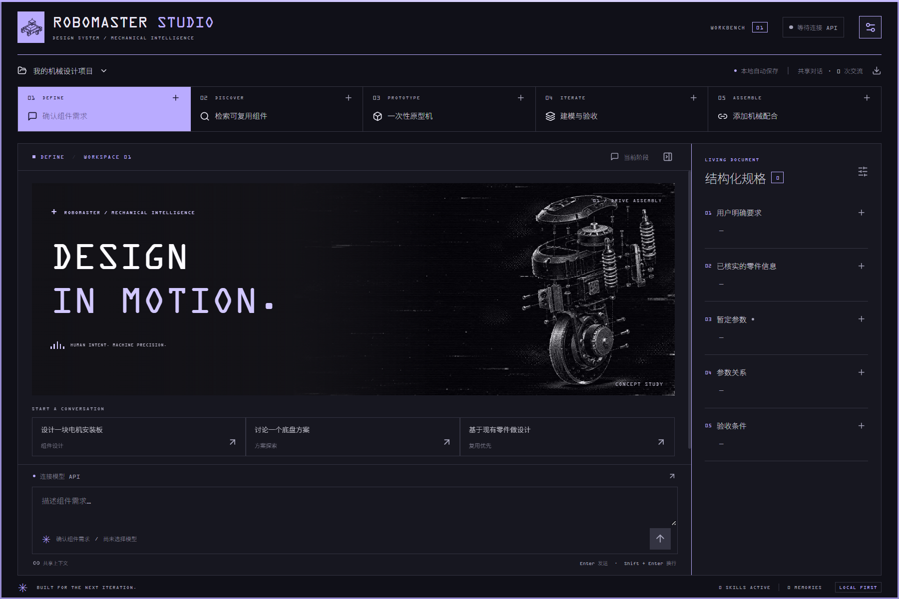
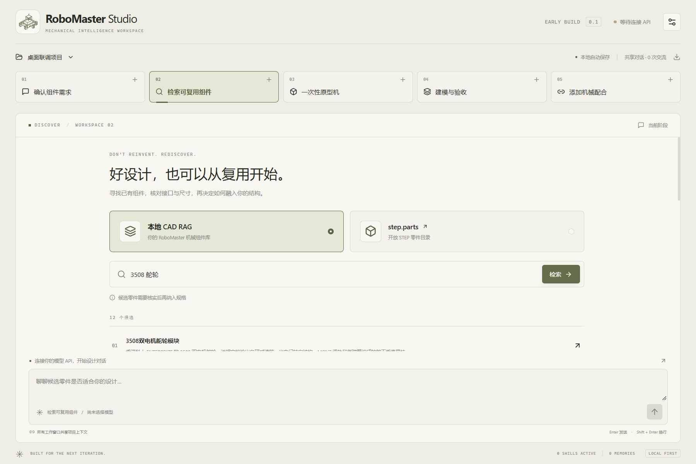
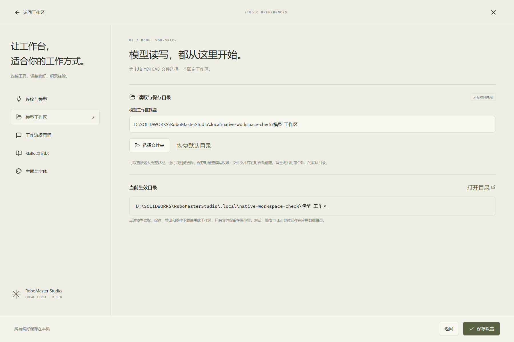
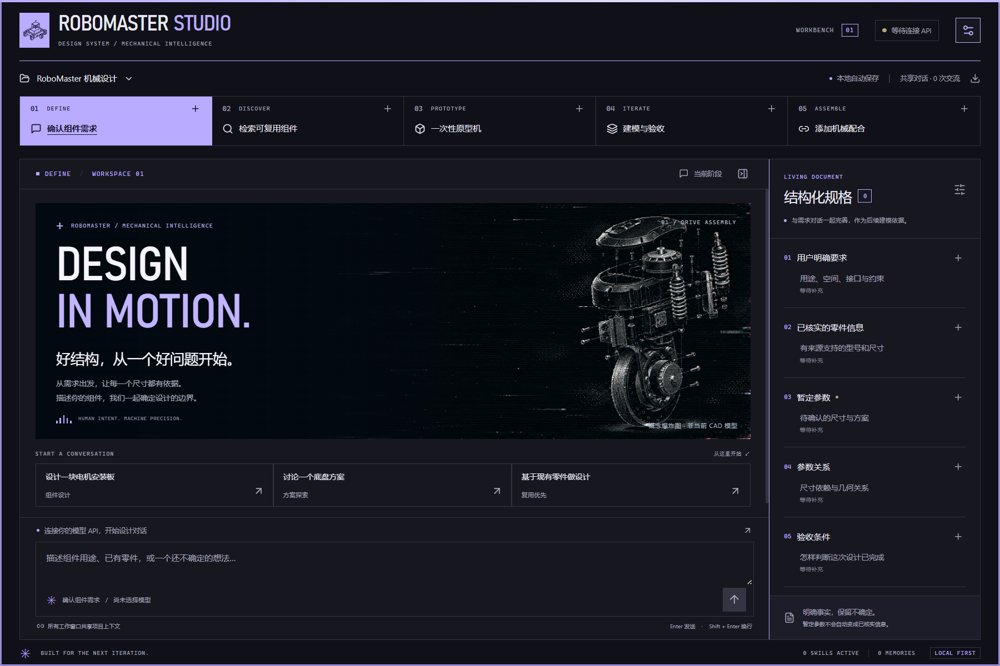
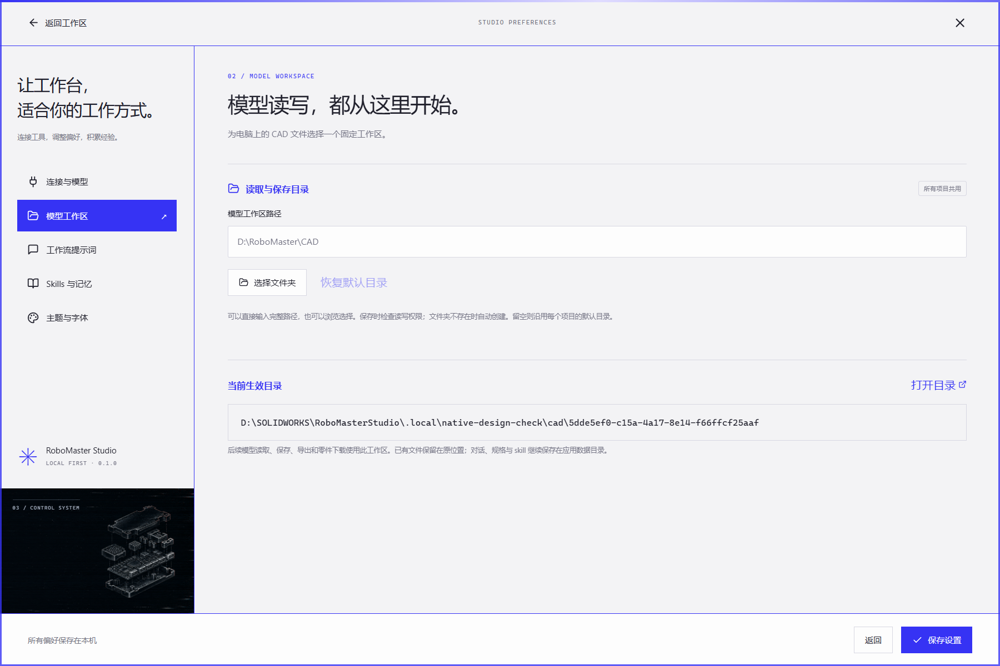
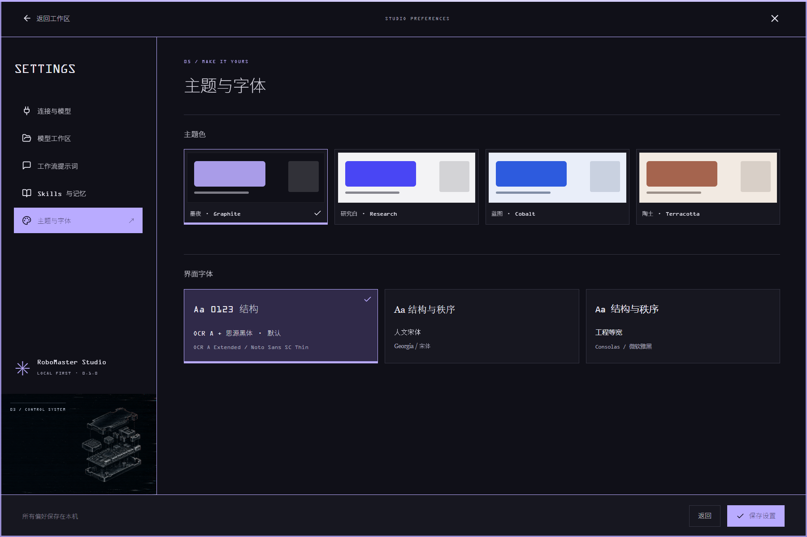
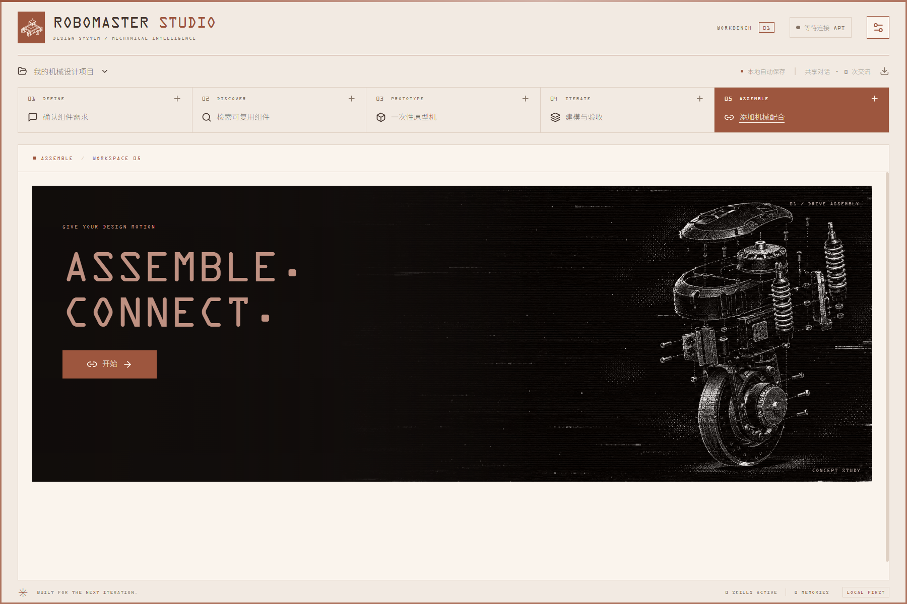

# v0.1.0 验证记录

验证日期：2026-11-12—2026-11-13（Asia/Singapore）。

## 已通过

| 检查 | 结果 | 范围 |
|---|---|---|
| TypeScript + Vite 生产构建 | 通过 | 编译与静态资源打包 |
| Rust 本地回归 | 22 项通过 | 窗口保底、原型权限、规格与记忆持久化、中文检索、skill 路径限制、人工选择暂停/恢复及结果写入、模型工具回路、摘要配对边界、意外退出恢复、MCP stdio 分页、凭据地址隔离、Responses 加密项续接、工作区兼容、路径检查、文件发现和保存路径转发；新增本机字体白名单和缺失回退 |
| Rust 真实接口检查 | 先前 2 项通过；本轮跳过 | 上游 MCP 握手、本地 RAG、step.parts 搜索与 STEP 下载指纹验证 |
| Playwright 界面回归 | 16 项通过 | 窗口增删、各阶段草稿、已核实规格来源、主题持久化、提示词编辑、配合单按钮、预览诚实提示、双检索入口、布局、切换阶段的滚动位置、模型工作区保存/恢复默认/放弃修改/无效路径提示、机械图片、指针反馈、减少动态效果和 1000×700 五阶段布局、默认墨夜、字体配置及按钮边缘流光；新增四主题配色一致性 |
| Windows release EXE 构建 | 通过 | 优化后的 x64 原生程序 |
| 打包后的原生程序联调 | 通过 | WebView2 → Tauri → Rust 的完整桌面调用链；真实服务和文件下载 |
| 视觉重设计原生检查 | 通过 | 最新 release EXE 中的三类图片、五阶段、鼠标菜单/Escape、工作区设置入口、主题持久化和减少动态效果 |
| 墨夜、字体与流光原生检查 | 通过 | 实际 OCR A Extended / Noto Sans SC Thin 字形、100 字重、五阶段与五设置页、光带角度随时间变化、紧凑布局与减少动态效果 |
| 四主题原生检查 | 通过 | 陶土、蓝图、研究白、墨夜的标题、背景、边框光带、按钮流光及配合按钮随主题切换，并在重载后保留 |

打包 EXE 的 SHA-256：

```text
58a22552b76e1cc02bba2cfb5b8463e6ed41768d5c00c0d8bc0463dfe8ec002a
```

初版功能联调具体结果见 [native-smoke-results.json](native-smoke-results.json)。以下真实服务结果来自视觉重设计之前的检查；本轮未修改 CAD / 模型业务后端，也未重新调用这些服务：

- 真实 MCP 发现 **66** 个工具，包括包围盒读取与同心配合工具。
- 本地 CAD RAG 对「3508 舵轮」返回 **12** 个候选，保留原帖、接口证据与复用限制。
- step.parts 对 `bearing` 查询的结果总数为 **132**。
- 下载 `bearing_608zz`，文件大小 **39,700 字节**，实际 SHA-256 与目录记录一致：`62d262cc91fb6e213ae85f182811201787e583d527d9a7718ea30a08e1f19fc9`。
- 在独立测试数据目录中添加规格、重载窗口、读取持久数据，结果一致。

## 实际窗口





## 模型工作区增量验证

新增「设置 → 模型工作区」，使用新版 release EXE 完成原生 UI → Rust → MCP / 下载调用链验证，结果见 [workspace-smoke-results.json](workspace-smoke-results.json)。

- 含中文与空格的新路径可由输入框保存，自动创建文件夹；页面重载后配置与生效路径一致。
- 模型可以列出所选目录内的已有 CAD 文件。模拟模型与模拟 MCP 联调验证：相对保存路径被转为所选目录的绝对路径；旧目录保存请求未发给 MCP。
- 真实上游 MCP 发现 66 个工具，并采用所选目录作为输出根路径。
- 真实下载 `bearing_608zz`（39,700 字节），文件位于所选工作区的 `downloads/<project-id>/`，实际大小一致。
- 相对工作区路径、把文件当文件夹的配置均被拒绝，保留原设置。
- 恢复默认目录后，已下载文件仍在原工作区，未被搬动或删除。

文件夹选择按钮使用原生系统对话框；本次自动化覆盖了手动输入路径，未人工操作该系统对话框。真实 CAD 保存仍以模拟 MCP 验证路径转发，未改动实际 SolidWorks 文档。



## 首轮视觉重设计验证

设计依据与动效规格见 [DESIGN.md](DESIGN.md)，首轮原生检查结果见 [design-smoke-results.json](design-smoke-results.json)。

- 通过真实浏览器的鼠标移动、点击、滚轮和键盘操作观察 Nous Research 的菜单、悬停、滚动与主题交互。当前会话没有可调用的 Edge 专用控制工具，观察使用独立 Chromium 浏览器，未接管用户的 Edge 标签页。
- 使用用户提供的三张机械爆炸图，原图保持不变；程序内不含人物或人物雕塑。图片打入应用资源，不依赖在线图片或字体。
- TypeScript、Vite 与 Windows release EXE 构建均通过。界面回归共 **14 项通过**。
- 使用最新 release EXE 在独立测试数据目录启动真实 WebView2，确认三类机械图片加载、五个阶段显示、菜单鼠标操作与 Escape 关闭、模型工作区设置可达。
- 夜间主题经过页面重载仍生效；系统减少动态效果偏好会禁用页面、图片与边框伪元素动画。
- 原生界面截图直接来自本次构建。此次视觉检查未调用付费模型、未修改 SolidWorks 文档，也未使用便携安装中的用户数据目录。





## 墨夜、字体与流光增量验证

该轮原生结果见 [refinement-smoke-results.json](refinement-smoke-results.json)。使用独立数据目录，不修改便携安装中的项目数据。

- 新配置默认墨夜，启动窗口与 HTML 首屏均使用深色；已有保存的主题仍保留。
- 从真实 WebView2 的字形记录确认英文大标题使用 `OCR A Extended / OCRAExtended`，中文导航和标题使用 `Noto Sans SC / Noto-Sans-SC-Thin`，并确认 `wght=100`。仅检查 CSS 字体名不足以证明实际字体，此处核对的是渲染字形。
- 字体通过受限原生命令从本机字体目录加载至内存，不复制进发布包。发现 WebView 本机字体集合静默回退的问题后，已用此方式解决。
- 悬停时边缘光带在约 1.6 秒内从 66.653° 移动至 192.691°；禁用按钮不发光，减少动态效果时停止动画。
- 核对五个工作阶段和五个设置页面，并在 1000×700 下确认没有横向溢出，输入与配合开始按钮可达。
- `npm test`：15 项通过。`cargo test --lib`：22 项通过、2 项真实外部服务检查跳过。生产前端与 release EXE 构建通过。
- 本次未调用付费模型或修改 SolidWorks 文档。



## 四主题一致性修复（2026-11-13）

最新原生结果见 [theme-smoke-results.json](theme-smoke-results.json)。本轮只修改前端样式，Rust 业务与字体加载实现未变。

- 删除旧基础样式中的重复色板；所有组件从当前主题色板或其明暗派生色取色。修复机械图标题、扫描光、顶部光带、配合开始按钮与结果区的固定紫蓝色。
- 原图文件不变，通过 CSS 灰度和亮度混合适配图版色调。
- 16 项界面回归通过，其中新增连续切换四个主题并检查需求、检索、建模、配合页面的实际颜色。
- 最新 release EXE 的原生检查验证四主题的标题色、图版底色、边框光带和按钮流光各自变化；配合按钮颜色与当前主题强调色完全一致。逐主题保存并重载后仍正确。
- OCR A Extended 与 Noto Sans SC Thin 均加载成功。未调用付费模型、未修改 CAD，测试数据与用户数据隔离。



## 尚未验证的外部条件

本次未获得用户的真实模型 API Key，因此**没有执行付费模型到真实 SolidWorks 建模的完整闭环**。模型回路与协议使用本地 HTTP 桩验证；真实 MCP 仅完成握手与工具发现，没有修改现有 CAD。

真实建模的收敛、复杂装配选面与机械性能仍需用户在配置模型后按项目验收。接口可用与零件满足设计要求分别记录。

## 环境问题与处理

- 默认 Cargo 缓存不在可写范围：使用项目 `.local/cargo/`；获取依赖时按 `Cargo.lock` 的 SHA-256 校验。
- Windows 沙箱临时目录的原子重命名失败：回归使用项目 `.local/test-temp/` 后通过；正常应用数据不放在该沙箱临时目录。
- 系统 Edge 不能在工具沙箱里启动：界面测试使用已有 Chromium headless shell；原生 WebView2 窗口实际启动成功。
- 开发服务器曾监听构建缓存与正在运行的 EXE，出现 EBUSY：Vite 已排除 `.local/`、`src-tauri/`、`release/`、测试结果和文档目录。
- Windows 沙箱中 Playwright 托管开发服务器的清理曾阻塞：测试脚本现在直接管理自己启动的 Vite 子进程，复用已有服务器时不终止它。最终 `npm test` 返回退出码 0，16 项通过。
- 新提供的浏览器插件在初始化时遭遇本机模块读取 `EPERM`，未接管 Edge。应用测试由项目测试套件与独立原生 WebView2 进程完成。

这些环境问题与真实模型配置缺失分开记录，未把未执行的付费模型验收计入通过项。
